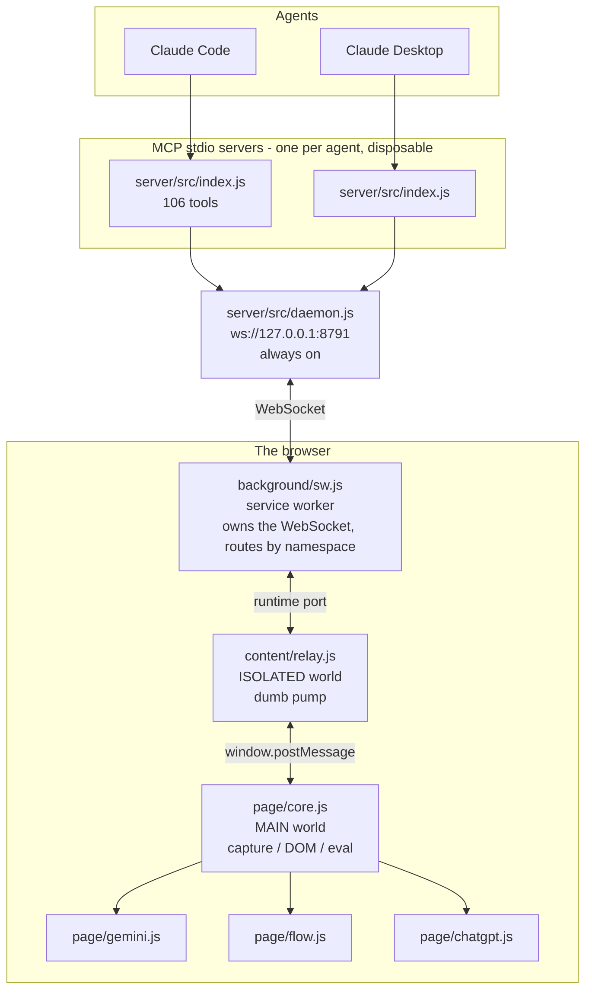

# Building an MCP bridge for Gemini, Flow and ChatGPT — how it works, and what went wrong

A narrative companion to [`CLAUDE.md`](CLAUDE.md). That file is the operational reference:
terse facts, ordered for lookup when something breaks. This one explains why the system is
shaped the way it is, which is mostly a story of assumptions that turned out to be wrong.

Everything here is measured. The figures come from the build verified on 2026-08-11:
Gemini `boq_assistant-bard-web-server_20260807.01`, Chrome 151, Edge 151.

---

## 1. What it is

106 MCP tools that drive the real, signed-in Gemini, Google Flow and ChatGPT tabs in the
operator's browser — prompt, stream, read history, switch models, toggle tools, attach
files, generate video — plus a general layer underneath for anything not yet wrapped.

The framing matters: **this is not a client for three APIs.** It has no keys and no
identity. It borrows sessions that already exist. That decision determines the
capabilities, the failure modes, and most of section 4.

It is a sibling of the WhatsApp bridge in the next directory, and deliberately so — the
architecture is the same one, and several of its scars were inherited rather than earned.

---

## 2. Why not just call the APIs

This was the first thing worth settling, because if an HTTP client works you should write
one. It does not, and each product blocks it differently:

- **ChatGPT** puts a sentinel proof-of-work in front of `/backend-api/conversation`. The
  page mints the token; an outside caller cannot.
- **Gemini** signs `StreamGenerate` with `SNlM0e`, an XSRF token issued only to a
  signed-in page render.
- **Flow** is the starkest. Its backend returns 401 to non-Chrome callers and requires a
  reCAPTCHA mint that cannot be reproduced headlessly. The most complete open-source Flow
  client drives a real browser for exactly this reason, and its author is on record asking
  whether anyone has managed a REST transport from outside a Chrome session.

So the bridge lives inside the page, where all three problems are already solved by
someone else. The interesting consequence is that **replaying a captured request is more
powerful than reconstructing one**: the template already carries the cookies, the bearer,
the XSRF token and the abuse-prevention state.

That is why `ai_net_list` → `ai_replay` is a first-class path and not a debugging aid. When
a Flow feature has no typed tool, the recipe is: do it once by hand, look at what it
called, replay that with a different prompt.

**Flow is the exception that proves the rule, and it took the longest to see.** Replay fails
there — not because the template is wrong, but because the one credential that matters is
*single-use*. Flow's generation endpoints demand a reCAPTCHA Enterprise token with a ~2 minute
life, so a replayed request carries a token that has already been spent. Replay and
reconstruction were both dead ends, and the conclusion looked like "Flow can only be driven
through its UI" for some time.

The way out is the third option: **reconstruct the body, but mint the credential in-page**.
`grecaptcha.enterprise.execute()` is sitting right there in the MAIN world — the same world the
bridge already runs in. Every published Flow client fails at this step because it is outside the
browser; being inside is not a workaround here, it is the entire capability. Generation went
from "UI only, slow, unverifiable" to a direct API call with real media ids in the response.

The transferable lesson: when replay fails, ask *which specific field* did not survive it. If
the answer is a token the page can mint on demand, reconstruct the request and mint that one
field. The distinction between "the page holds a credential" and "the page can *issue* a
credential" is what decides whether replay or reconstruction is the right architecture.

---

## 3. Architecture

Four processes, three JavaScript execution contexts, one WebSocket.

**Why the daemon is separate.** Inherited from the WhatsApp bridge, where putting the
socket in the MCP process meant the extension showed "disconnected" whenever no agent was
running, and two agents fought over the port. A separate daemon fixes both, and a duplicate
exits cleanly on `EADDRINUSE`, which makes on-demand spawning safe to fire blindly.

**Why three browser contexts.** Not a choice — MV3's isolation model. Only the MAIN world
can touch the page's JavaScript; only the ISOLATED world has `chrome.runtime`; only the
service worker's requests are attributed to the extension origin, which is what dodges
Private Network Access blocking on `127.0.0.1`.

**What is new here** is routing. One extension covers three sites, so the worker dispatches
on the method namespace: `gemini.*` to the Gemini tab, `chatgpt.*` to ChatGPT, and the
site-agnostic namespaces (`sys.*`, `dom.*`, `net.*`) to whichever tab the caller names. With
several tabs connected and no name given it returns `ambiguous_site` and lists the
candidates — guessing would have been worse.

**The three primitives** the site modules are built from: network capture, replay, and DOM
driving. Everything else is composition.

---

## 4. What went wrong

### 4.1 Trusted Types closes every door at once

gemini.google.com sends `require-trusted-types-for 'script'`. The first symptom was the
in-page test suite failing on `host.innerHTML = '<button>…'`.

Rewriting the fixture with `DOMParser.parseFromString` failed identically — it is also a
TrustedHTML sink. So the fixture became `createElement` and `textContent`, via a small
`el()` helper, and the same fix was needed in `typeInto`'s last-resort fallback, which had
been clearing an editor with `innerHTML = ''`.

Then `sys.eval` failed on all three of its strategies at once: `new Function` ("Evaluating
a string as JavaScript violates this document's Trusted Type assignment requirements"),
`script.src` (needs TrustedScriptURL), `script.textContent` (needs TrustedScript). Trusted
Types does not close one route into the engine — it closes all of them together.

The way through is that the CSP requires trusted types but does **not** restrict policy
*names*. `trustedTypes.createPolicy('aimcp-<epoch>', …)` succeeds, and its output satisfies
the sinks. The policy is named per epoch because `createPolicy` refuses a duplicate name and
the bridge is re-injected on every extension reload. Where a site does restrict names, the
error says so instead of listing three identical-looking failures.

**The general lesson:** a CSP feature that blocks one sink probably blocks its neighbours.
Test the fallback path on the strictest site, not the friendliest.

### 4.2 The browser will not load the extension

Three separate walls, in one evening, all presenting as "the bridge never connects":

- **Chrome 137+ refuses the switch.** `--load-extension` and `--disable-extensions-except`
  are disabled in branded Chrome. It starts perfectly and loads nothing. The only reason
  this was diagnosed rather than guessed at is that Chrome's own log says
  `--disable-extensions-except is not allowed in Google Chrome, ignoring` — so the e2e now
  prints the browser's target list on failure and says explicitly whether an extension is
  present. Edge and Opera still honour the switch; Chrome is fine when the extension is
  loaded by hand.
- **Unpacked extensions will not load from a network drive.** This repo lives on one. The
  browser starts, the page loads, nothing connects. Both launchers stage a local copy.
- **`spawn UNKNOWN`** launching any browser — a UNC working directory. `cwd: tmpdir()`.

A fourth, smaller one: the Playwright-managed chromium on this machine passes `existsSync`
and then fails to start with a broken side-by-side manifest. **File presence is not
evidence that a binary will run**, so the launcher walks its candidates until one actually
spawns rather than picking the first that exists.

### 4.3 The bug that was not there

The longest detour, and the most instructive.

After fixing Trusted Types, the suite kept reporting the old Trusted Types failure. Then
`net.request` stopped appearing in the capture buffer — a feature that had just been
written and whose code was plainly present in the file. Staged copies on disk were checked
byte for byte and were correct. `cpSync` from the network drive was suspected and cleared.
The same run passed an assertion in one invocation and failed it in the next.

The cause: **another browser was connected to the same port.** An earlier throwaway probe —
a PowerShell function written to test whether Edge and Opera accept `--load-extension` at
all — had left an Edge running, staged from a build several hours old. It reconnected every
few seconds, the stub server accepted the newest connection, and the suite drove *that*
browser while reporting the results as its own.

Three defences now exist, and they are worth more than the fix:

1. `e2e.mjs` kills any browser whose command line has `--load-extension` together with
   `ai-mcp` or `aimcp` before it starts. The first cleanup pattern missed the culprit
   because that probe used the prefix `aimcp-p-`, without the hyphen.
2. If any site tab is connected *before* the suite opens its own, it aborts with an
   explanation instead of producing a page of misleading failures.
3. Every run asserts that the bridge's `CORE_VERSION` equals the number read out of the
   source file. That single assertion would have collapsed the whole investigation into one
   line, and it is the reason the version constant exists.

**The lesson is not "kill stray processes."** It is that when a test harness can attach to
something other than what it just built, it will eventually do so silently — so identity
has to be asserted, not assumed.

### 4.4 Reading the answer

Two products, two opposite problems.

**ChatGPT** renders markdown to HTML. Reading the reply out of the DOM means converting it
back, and code fences, tables and maths do not survive the round trip. The SSE stream still
carries the original markdown, so the stream is the source of truth and the rendered text
is returned alongside as a cross-check.

Decoding that stream is where a plausible wrong answer lives. It is a delta protocol: an
`add` frame establishes a message shell, then hundreds of `{p, o, v}` operations append
fragments into `/message/content/parts/N`. Reasoning traces, tool calls and the visible
answer all share one stream. A decoder that appends every string it sees returns the
model's scratchpad as the answer — which looks entirely reasonable until you read it. So
appends are taken only while the message being built has `content_type: "text"` and
`recipient: "all"`, and there are assertions for the reasoning case, the tool-call case,
batched patches, and a final full frame superseding the deltas.

**Gemini** has no stream worth parsing — `StreamGenerate` returns deeply nested positional
arrays whose indices move between releases, which is precisely the shape that keeps working
while quietly returning the wrong field. But it also keeps no copy of its source markdown.
So there the HTML *is* converted back, deliberately and with tests: headings, bold, italic,
inline code, fenced blocks with language, ordered and unordered lists, links, pipe tables,
blockquotes. One of those tests exists because Gemini renders a language chip and a Copy
button *inside* the `<pre>`, and `textContent` folds both into the snippet.

The identifiers are pulled out with a regex instead: `c_…`, `r_…`, `rc_…` are recognisable
on sight, which is far more durable than indexing into an array.

### 4.5 Knowing when it has finished

Every individual completion signal lies.

The stop button disappears slightly before the last tokens render. The DOM keeps growing
after the stream closes. The network record completes while React is still flushing. And a
Deep Research run pauses for minutes mid-answer, so "the text stopped changing" on its own
declares victory early.

`waitForReply` requires the stop button gone **and** the text stable for a quiet period,
and while the stop button is up the stability poll returns a deliberately changing value so
it cannot settle during a pause. Then it waits for the captured request to close before
decoding it.

### 4.6 Editors that ignore you

ProseMirror (ChatGPT) and Quill (Gemini) keep an internal document that the visible DOM
only reflects. Writing `textContent` updates the pixels and nothing else — the app then
sends an empty prompt, and the tool reports success.

`typeInto` walks four strategies — `execCommand('insertText')`, a synthetic paste, the
native value setter, and a direct DOM write — verifies the text actually landed, and
reports which one the editor accepted. The direct write carries a warning in its result,
because it is the one that can go in without the editor's blessing.

File uploads have the same shape: assigning a `DataTransfer` FileList to the hidden
`input[type=file]` and firing `change` works; dispatching a synthetic `drop` does not,
because the event is untrusted.

### 4.7 Small things that would have been silent

- **`net.request` and `net.replay` did not record themselves.** They use the *original*
  fetch to avoid recursing through the capture hook, and the first version simply forgot to
  file the result. A replay you cannot inspect or replay again is half a feature. Both now
  go through one `issue()` helper that creates a real record.
- **Record ids sort as strings.** `since_id` compared `n9 > n10` and got the wrong answer.
  The comparison now uses the numeric tail, and it has to handle the `replay-` and `req-`
  prefixes too, since all three share one counter.
- **`hl` was read from the wrong key.** The obfuscated `WIZ_global_data` field that used to
  hold the language now contains `/_/BardChatUi`. The server *accepts* a nonsense `hl` and
  answers in the wrong language rather than failing, so this had to be caught by asserting
  the shape. It now comes from a captured request, validated against a language-tag pattern.
- **Readiness gating hid the diagnostics.** `flow.status` was refused for 60 seconds
  because Flow was not ready — but "not ready" is exactly when you call `status`. Anything
  matching `status|probe|observe|tokens|credits` now bypasses the gate, extending a rule the
  core already applied to `sys.*`.
- **A missing required argument travelled to the browser** and came back as a timeout
  minutes later, which reads as a broken bridge. The server now refuses it in milliseconds
  and names the argument.

---

## 5. Testing

Five suites, **488 assertions** that need no account, plus a live suite that does.

| Suite | Count | Runs against |
|---|---|---|
| `server/src/selftest.js` | 91 | offline — daemon lifecycle, routing, chunk reassembly, policy, media |
| `scripts/mcp-check.mjs` | 35 (+5 `--live`) | MCP protocol over real stdio |
| `scripts/e2e.mjs` | 120 | a real browser, all three sites, signed out |
| `sys.selftest` in-page | 89 / 77 / 76 | synthetic data inside each live page |
| `scripts/verify-live.mjs` | 40+ | real signed-in accounts |

The shape follows from the dominant failure mode. When a broken tool returns a plausible
empty result rather than throwing, a test that asserts "it did not throw" is worthless.
So: `waitStable` is checked against a value that grows and then stops; the ChatGPT stream
decoder is checked against reasoning traces and tool calls it must exclude; the markdown
reconstruction is checked fence by fence; the daemon's chunk reassembly is fed frames
**out of order**, because keying on arrival instead of `seq` is the obvious bug.

Two principles earned their place here specifically:

- **In-page tests must pass signed out.** That is what separates "the bridge is broken"
  from "you are not logged in", and it means the suite is useful on a fresh machine.
- **Assert identity, not just behaviour.** See 4.3.

---

## 6. What I would tell someone starting this

**Being inside the page is the whole product.** Every hard problem in these three products —
proof-of-work, XSRF, reCAPTCHA, bot detection — is already solved by the browser that is
running. Capture and replay, do not reconstruct.

**Treat selectors as evidence, not code.** Every lookup is a list of candidates and reports
which one matched, and one call dumps the live structure. On sites that redesign this often,
the difference between a broken tool and a five-minute fix is entirely whether you can see
what changed.

**Two sources beat one.** The stream and the DOM disagree in useful ways: the stream has the
markdown, the DOM has the render. Returning both, labelled, costs nothing and catches the
case where one of them silently degrades.

**Prefer refusing to guessing.** `ambiguous_site` with a list of candidates is better than
picking a tab. A named `eval_blocked` with all three strategies' errors is better than a
generic failure. An honest gap is recoverable; a confident wrong answer is not.

**Write the environment traps down the moment they cost you an hour.** Chrome's extension
switch, the network-drive load failure, the UNC spawn error and the stale-browser
attachment each cost real time, and three of them present as the same symptom: "it never
connects".

---

## 7. Terse reference facts (moved from CLAUDE.md, 2026-08-12 kernel split)

CLAUDE.md kept sections 1-4 (Shape, Method routing, Run things, Environment traps) and 9 (Policy) as the always-loaded kernel. These sections — verbatim, headings demoted one level since they keep their original CLAUDE.md numbers (5, 6, 7, 8, 10) rather than renumbering into this file's scheme — are the deep implementation facts only needed when debugging a specific site integration or adding a new tool.

### 5. Page-side facts

#### Trusted Types (gemini.google.com)
`require-trusted-types-for 'script'` closes every HTML and script sink at once:
`innerHTML`, `DOMParser.parseFromString`, `script.src`, `script.textContent`, `new Function`.

- Build DOM with `util.el(tag, attrs, ...children)` — `createElement` + `textContent` only.
- `runCode()` mints a policy named `aimcp-<epoch>` (per epoch: `createPolicy` refuses a
  duplicate name) and uses it for `script.src` / `script.textContent`. Gemini's CSP does not
  restrict policy names, so this works; where it does, `eval_blocked` says so explicitly.

#### Network capture
Installed at `document_start` on `fetch` and `XMLHttpRequest`. Google still uses XHR for
`batchexecute`, so a fetch-only hook sees almost nothing on Gemini.

- Responses are read via `res.clone()`, never `tee()` + `new Response(...)` — reconstructing
  drops `res.url`/`redirected`/`type`, which app code reads.
- Skips images, fonts, media, and analytics beacons by URL and content-type.
- `net.request` and `net.replay` file their own calls into the buffer via `issue()`, so a
  replay is inspectable and re-replayable.
- Ids are `n<seq>`; `since_id` compares the numeric tail, so `n9` sorts before `n10`.

#### Site identifiers
| | |
|---|---|
| Gemini conversation | `/app/<id>` in the path; `c_…` / `r_…` / `rc_…` regex-matched out of the raw StreamGenerate body |
| Gemini tokens | `at` = `WIZ_global_data.SNlM0e` (signed-in only), `bl` = `cfb2h`, `f.sid` = `FdrFJe`; `hl` comes from a captured request because the WIZ key for it moved and now holds `/_/BardChatUi` |
| ChatGPT conversation | `/c/<uuid>`; also `conversation_id` in the SSE stream |
| ChatGPT auth | bearer harvested from a captured `/backend-api/` request first, `/api/auth/session` as fallback |
| Flow project | `/fx/tools/flow/project/<id>` |

#### ChatGPT stream decoding
Delta protocol: an `add` frame establishes a message, then `{p, o, v}` ops append into
`/message/content/parts/N`. Reasoning traces, tool calls and the answer share one stream —
appends are only taken while the active message has `content_type: "text"` and
`recipient: "all"`, or a thinking model returns its scratchpad as the answer.

### 6. Selectors

Every lookup takes a **list** of candidates; `pick()` reports which one matched.
`sys.probe` resolves all of them plus every visible button, custom element and test id.
When a tool stops finding something, that is one call, not a debugging session.

Live values confirmed on the 2026-08 builds:

- Gemini composer `rich-textarea .ql-editor[contenteditable="true"]`, send
  `button[aria-label="Send message"]` (only rendered once the editor has content), model
  picker `button[data-test-id="bard-mode-menu-button"]`.
- ChatGPT composer `#prompt-textarea` / `div.ProseMirror[contenteditable="true"]`, send
  `#composer-submit-button`, stop `[data-testid="stop-button"]`, turns
  `[data-testid^="conversation-turn-"]`, messages `[data-message-author-role]`.
- Flow has no stable markup; its module matches on visible text and roles, and leans on
  `flow_observe` + `ai_replay`.

### 7. Editors

`typeInto()` walks four strategies and reports which the editor accepted:
`execCommand('insertText')` → synthetic `paste` → native value setter → direct DOM write
(flagged with a warning). ProseMirror and Quill keep an internal document that plain DOM
writes do not touch — the app then sends an empty prompt, which looks like success.

File uploads assign a `DataTransfer` FileList to the hidden `input[type=file]` and fire
`change`. A synthetic `drop` is untrusted and ignored.

### 8. Waiting for an answer

Three signals, because each lies alone: the stop button disappears before the last tokens
render, the DOM keeps growing after the stream closes, and the network record completes
while React is still flushing. `waitForReply` requires the stop button gone **and** the
text stable for `quiet_ms`, then decodes the captured stream. While the stop button is up,
the poll returns a changing sentinel so a long pause between tool calls cannot settle early.

### 10. Adding a tool

1. Handler in the relevant `extension/page/*.js`, registered on `A.H['<site>.<name>']`.
2. Assertion in that module's `selftest()` that pins a **value**, not the absence of a throw.
3. Tool in `server/src/tools.js` — every parameter needs a description; the offline selftest
   fails otherwise.
4. Policy sets if it writes.
5. `node scripts/mcp-check.mjs` — a fresh server process is the only honest check, because a
   connected agent keeps the schema it saw at session start.
6. `node scripts/e2e.mjs` before claiming it works.

Editing extension source? The browser caches unpacked extension resources: reloading the
**page** re-injects the cached copy. `ai_reload_extension` (or the popup's Re-inject) is
what picks up changes.
